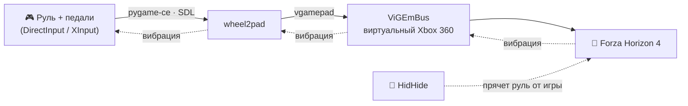

<div align="center">


# wheel2pad

**Руль превращается в геймпад Xbox 360 — игра даже не заметит подмены.**

Для руля **Artplays V-1200 Vibro** и похожих USB-рулей, которые игры вроде
**Forza Horizon 4** не понимают «из коробки».

[](https://github.com/BOBUS2317/wheel2pad/actions/workflows/build-exe.yml)


</div>

---

## Зачем это

Forza Horizon 4 плохо дружит с бюджетными рулями: оси путаются, педали не
определяются, раскладку приходится собирать вручную. Зато геймпад Xbox игра
понимает идеально.

**wheel2pad** читает руль и на лету выдаёт виртуальный геймпад Xbox 360. В игре
остаются **стандартные настройки геймпада** — ничего перенастраивать не нужно.



## ✨ Возможности

- 🧭 **Мастер калибровки** — сам находит ось руля и педалей: ничего не нужно знать
  про номера осей, они разные в режимах DirectInput и XInput.
- 🔁 Понимает **инвертированные оси** и **газ с тормозом на одной оси**.
- 🦶 Сцепление можно превратить в кнопку (по умолчанию LB).
- 📳 **Вибрация из игры** передаётся на руль, если руль её принимает.
- 🔌 Руль можно выдернуть и вставить обратно — эмуляция продолжится сама;
  если руля нет при запуске, программа просто подождёт его.
- 📦 **Один файл `wheel2pad.exe`**, как у x360ce: без Python, без папок и
  вспомогательных файлов. Драйвер ViGEmBus вшит внутрь и ставится по запросу.
- ⌨️ Перенастройка руля и путь для HidHide — командами прямо в окне программы.

## 🎯 Что во что превращается

| На руле | Геймпад Xbox 360 |
|---|---|
| Поворот руля | Левый стик, ось X |
| Газ | Правый курок **RT** |
| Тормоз | Левый курок **LT** |
| Сцепление | Кнопка (по умолчанию **LB**, можно отключить) |
| Кнопки, лепестки, крестовина | Назначаются при калибровке |
| Вибрация из игры | Вибромотор руля |

<details>
<summary><b>Рекомендованная раскладка для Forza Horizon 4</b></summary>

| Кнопка руля | Кнопка Xbox | Действие в FH4 |
|---|---|---|
| Правый лепесток | **B** | Передача вверх |
| Левый лепесток | **X** | Передача вниз |
| Любая удобная | **A** | Ручник |
| Любая удобная | **Y** | Перемотка (Rewind) |
| Любая удобная | **START** | Пауза |
| Крестовина | **DPAD** | Меню, навигация |

Кнопку **MODE** на руле не назначайте — она переключает режимы самого руля.
Руль лучше перевести в режим **270°**: в 900° для полного поворота стика придётся
крутить почти три оборота (или уменьшите `steer_range`, см. ниже).

</details>

## 🚀 Быстрый старт

### 1. Скачайте программу

**Вариант А — готовый exe (Python не нужен).**
Скачайте `wheel2pad.exe` со страницы
[**Releases**](https://github.com/BOBUS2317/wheel2pad/releases/latest) и положите
в постоянную папку (например, `Документы\Руль`) — HidHide запоминает путь к файлу.
Или соберите сами — см. [Сборка exe](#-сборка-exe).

**Вариант Б — из исходников.**
Скачайте репозиторий и запустите `start.bat`. В первый раз он сам найдёт
(или поставит через `winget`) Python и все зависимости.

### 2. Установите драйвер ViGEmBus

Он создаёт виртуальный геймпад, нужен один раз. Если драйвера нет, wheel2pad
сам предложит открыть установщик. После установки — перезагрузка.

### 3. Спрячьте руль от игры с помощью HidHide

> [!IMPORTANT]
> Без [HidHide](https://github.com/nefarius/HidHide/releases) игра видит **и** руль,
> **и** виртуальный геймпад одновременно — управление дёргается.

1. Установите HidHide и откройте **HidHide Configuration Client**.
2. Вкладка **Applications** → добавьте wheel2pad, чтобы *он* руль видел.
   Нужный путь скопирует в буфер сама программа: введите в её окне **H** и
   нажмите Enter (при запуске через Python — `hidhide_path.bat`).
   В окне выбора файла HidHide останется нажать Ctrl+V и Enter.
3. Вкладка **Devices** → отметьте руль и включите **Enable device hiding**.

### 4. Откалибруйте и играйте

Запустите `wheel2pad.exe` (или `start.bat`) — при первом запуске откроется
мастер калибровки:

```text
1) Отпустите педали, руль по центру            → Enter
2) Руль до упора ВЛЕВО                          → Enter
3) Руль до упора ВПРАВО                         → Enter
4) Газ до упора и отпустить                     → Enter
5) Тормоз до упора и отпустить                  → Enter
6) Сцепление (если есть)                        → Enter
   Для каждой кнопки Xbox — нажать кнопку руля (Enter — пропустить)
```

Настройки сохранятся в `wheel2pad.json` рядом с программой (как `x360ce.ini`
у x360ce). Дальше просто запускайте программу, сворачивайте окно и запускайте игру.

## ⌨️ Команды в окне программы

Пока программа работает (или ждёт руль), щёлкните по её окну, введите букву и
нажмите Enter. Русская раскладка тоже подходит — та же клавиша.

| Клавиша | Что делает |
|---|---|
| **R** (к) | Перенастроить руль — калибровка без перезапуска программы |
| **H** (р) | Показать путь для HidHide и скопировать его в буфер обмена |
| Enter | Напомнить список команд |

## 🧰 Флаги командной строки

| Флаг | Что делает |
|---|---|
| *(без флагов)* | Эмуляция; если настроек ещё нет — сначала калибровка |
| `--calibrate` | Пройти калибровку заново |
| `--show` | Эмуляция + строка с текущими значениями руля, педалей и кнопок |
| `--monitor` | «Сырые» оси, кнопки и крестовина руля — для диагностики |
| `--list` | Список всех игровых устройств |
| `--where` | Путь к exe/`python.exe` для HidHide (сразу копируется в буфер) |

## 🎛️ Тонкая настройка

Блок `settings` в `wheel2pad.json`:

| Параметр | По умолчанию | Что делает |
|---|---|---|
| `steer_range` | `1.0` | Доля хода руля до полного стика. Для режима 900° — `0.3`–`0.5` |
| `steer_deadzone` | `0.02` | Мёртвая зона в центре руля |
| `steer_anti_deadzone` | `0.0` | Компенсация мёртвой зоны игры (`0.1`–`0.2`, если мелкие повороты «не доходят») |
| `steer_gamma` | `1.0` | Больше 1 — мягче около центра, меньше 1 — острее |
| `pedal_deadzone` | `0.04` | Чтобы отпущенная педаль давала ровно 0 % |
| `pedal_top_deadzone` | `0.03` | Чтобы педаль в пол гарантированно давала 100 % |
| `clutch_button` | `"LB"` | Куда отправлять сцепление; `""` — никуда |
| `clutch_threshold` | `0.5` | Насколько выжать сцепление, чтобы кнопка сработала |
| `rumble` | `true` | Передавать вибрацию на руль |
| `rate_hz` | `500` | Частота опроса руля |

К одной кнопке Xbox можно привязать несколько кнопок руля — допишите их в
список в разделе `buttons`.

## 🛠️ Сборка exe

**Локально (Windows):**

1. Один раз запустите `start.bat` — он поставит Python и зависимости в `.venv`.
2. Запустите `build_exe.bat`.
3. Готово: `release\wheel2pad.exe` — единственный файл, который нужно отдать.

**В облаке (GitHub Actions):**

- **Релиз** — запушьте тег вида `v1.0`: сборка сама создаст релиз на странице
  **Releases** и приложит к нему `wheel2pad.exe`.
  ```bash
  git tag v1.0 && git push origin v1.0
  ```
- **Пробная сборка** — **Actions** → **Build wheel2pad.exe** → **Run workflow**.
  Результат — артефакт **Wheel2Pad** (GitHub всегда упаковывает артефакты в zip,
  внутри — только exe).

Сборка заодно проверяет, что установщик ViGEmBus действительно попал внутрь exe.

> [!NOTE]
> Пошаговая инструкция для конечного пользователя хранится только локально
> (`release_files/ИНСТРУКЦИЯ.txt`) и в репозиторий не входит — её передают
> отдельно от exe.

<details>
<summary><b>Антивирус ругается на exe</b></summary>

Exe, собранные PyInstaller в режиме `--onefile`, иногда ложно считаются
подозрительными. Варианты: добавить папку в исключения Защитника или собрать в
режиме папки — заменить `--onefile` на `--onedir` в `build_exe.bat` и workflow
(результат — `build\dist\wheel2pad\` с exe и папкой `_internal`; поправьте
копирование в шаге 3/3, чтобы копировалась вся папка).

</details>

## 🩺 Если что-то не так

| Проблема | Что делать |
|---|---|
| «Руль не найден, жду подключения» | Проверьте USB. Если стоит HidHide — путь (он уже в буфере) должен быть во вкладке **Applications** |
| Руль подключили другой или сменили режим (D-Input ↔ X-Input) | Введите **R** и Enter — калибровка заново |
| Калибровка не видит ось или кнопку | Посмотрите, что шлёт руль: `--monitor` |
| Управление дёргается, в игре два контроллера | Руль не спрятан — настройте HidHide (шаг 3) |
| «Не удалось создать виртуальный геймпад» | Не установлен ViGEmBus — согласитесь на установку и перезагрузитесь |
| Руль поворачивается слишком туго / слишком резко | `steer_range`, `steer_gamma`, `steer_anti_deadzone` |
| Нет вибрации | Не все режимы руля её принимают — программа напишет об этом и продолжит без неё |

## 📁 Структура проекта

```text
wheel2pad/
├── wheel2pad.py              # программа: руль (pygame-ce) → Xbox 360 (vgamepad)
├── requirements.txt          # pygame-ce, vgamepad
├── start.bat                 # запуск через Python, при первом запуске всё ставит
├── calibrate.bat             # start.bat --calibrate
├── hidhide_path.bat          # путь к python.exe для HidHide
├── build_exe.bat             # сборка одного wheel2pad.exe через PyInstaller
├── assets/
│   ├── wheel2pad.ico         # иконка exe
│   └── icon.gif              # исходный пиксель-арт иконки
└── .github/workflows/
    └── build-exe.yml         # та же сборка в GitHub Actions + релиз по тегу
```

## 🧪 Что проверено

- ✅ Логика на заглушках pygame/vgamepad: мастер калибровки (раздельные и общая
  ось педалей, инвертированный руль, сцепление, кнопки и крестовина), пересчёт
  осей и мёртвых зон, вибрация, отключение и повторное подключение руля,
  ожидание руля при запуске, команды R и H, сообщение об отсутствии ViGEmBus,
  `--where`.
- ⏳ Ещё не проверено на живом железе: реальный руль Artplays, работа в FH4,
  вибрация на этом руле, HidHide с onefile-exe, сборка exe.

## 🙏 Благодарности

- [ViGEmBus](https://github.com/nefarius/ViGEmBus) и [HidHide](https://github.com/nefarius/HidHide) — Nefarius
- [vgamepad](https://github.com/yannbouteiller/vgamepad) — Python-обёртка над ViGEmBus
- [pygame-ce](https://github.com/pygame-community/pygame-ce) — чтение руля через SDL
