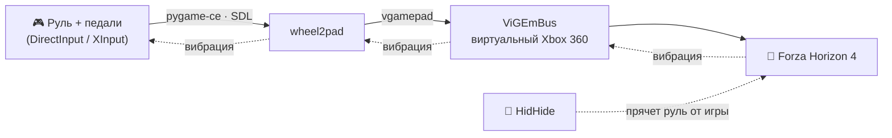

<div align="center">


# wheel2pad

**Руль превращается в геймпад Xbox 360 — игра даже не заметит подмены.**

Для руля **Artplays V-1200 Vibro** и похожих USB-рулей, которые игры вроде
**Forza Horizon 4** не понимают «из коробки».

<!-- Ссылка .../releases/latest/download/... всегда ведёт на exe из последнего релиза -->
[](https://github.com/BOBUS2317/wheel2pad/releases/latest/download/wheel2pad.exe)

[](https://github.com/BOBUS2317/wheel2pad/releases/latest)
· один файл, Python не нужен · Windows 10/11 ·
[все версии и что нового](https://github.com/BOBUS2317/wheel2pad/releases)

</div>

> [!TIP]
> **Как скачать и запустить**
> 1. Нажмите зелёную кнопку выше — скачается `wheel2pad.exe`.
> 2. Положите его в постоянную папку (например, `Документы\Руль`), а не в «Загрузки»:
>    HidHide запоминает путь к файлу.
> 3. Запустите двойным щелчком — дальше программа всё подскажет сама.
>
> У exe нет цифровой подписи, поэтому Windows может перестраховаться:
> - **браузер** «файл может быть опасен» → **⋯** → **Сохранить** → **Всё равно сохранить**;
> - **SmartScreen** «Windows защитила ваш компьютер» → **Подробнее** → **Выполнить в любом случае**.

<div align="center">

[](https://github.com/BOBUS2317/wheel2pad/actions/workflows/build-exe.yml)


</div>

---

## Зачем это

Forza Horizon 4 плохо дружит с бюджетными рулями: оси путаются, педали не
определяются, раскладку приходится собирать вручную. Зато геймпад Xbox игра
понимает идеально.

**wheel2pad** читает руль и на лету выдаёт виртуальный геймпад Xbox 360. В игре
остаются **стандартные настройки геймпада** — ничего перенастраивать не нужно.



## ✨ Возможности

- 🧭 **Мастер калибровки** — сам находит ось руля и педалей: ничего не нужно знать
  про номера осей, они разные в режимах DirectInput и XInput.
- 🪟 **Окно кнопок в духе x360ce** — в реальном времени видно, что приходит с руля
  и что получает игра (нарисованный геймпад Xbox и числа); кнопки переназначаются
  выпадающим списком или нажатием на руле, есть «Авто», ползунки чувствительности
  и крупная надпись, в каком режиме руль (X-Input / D-Input).
- 🔁 Понимает **инвертированные оси** и **газ с тормозом на одной оси**.
- 🦶 Сцепление можно превратить в кнопку (по умолчанию LB).
- 📳 **Вибрация из игры** передаётся на руль, если руль её принимает.
- 🔌 Руль можно выдернуть и вставить обратно — эмуляция продолжится сама;
  если руля нет при запуске, программа просто подождёт его.
- 📦 **Один файл `wheel2pad.exe`**, как у x360ce: без Python, без папок и
  вспомогательных файлов. Драйвер ViGEmBus вшит внутрь и ставится по запросу.
- ⌨️ Перенастройка руля и путь для HidHide — командами прямо в окне программы.

## 🎯 Что во что превращается

| На руле | Геймпад Xbox 360 |
|---|---|
| Поворот руля | Левый стик, ось X |
| Газ | Правый курок **RT** |
| Тормоз | Левый курок **LT** |
| Сцепление | Кнопка (по умолчанию **LB**, можно отключить) |
| Кнопки, лепестки, крестовина | Назначаются при калибровке |
| Вибрация из игры | Вибромотор руля |

<details>
<summary><b>Рекомендованная раскладка для Forza Horizon 4</b></summary>

Мастер калибровки подсказывает ровно эту раскладку — названиями со схемы руля
Artplays V-1200 («на руле: лепесток R1» и т. п.).

| Кнопка руля (Artplays V-1200) | Кнопка Xbox | Действие в FH4 |
|---|---|---|
| Лепесток **R1** | **B** | Передача вверх |
| Лепесток **L1** | **X** | Передача вниз |
| **A** | **A** | Ручник |
| **Y** | **Y** | Перемотка (Rewind) |
| **SHARE** | **BACK** (View) | |
| **OPTIONS** | **START** (Menu) | Пауза |
| Крестовина | **DPAD** | Меню, навигация |

Кнопку **MODE** на руле не назначайте — она переключает режимы самого руля.
Руль лучше перевести в режим **270°**: в 900° для полного поворота стика придётся
крутить почти три оборота (или уменьшите `steer_range`, см. ниже).

В самой FH4, в расширенных настройках управления, мёртвые зоны оси руля стоит
свести к минимуму: внутреннюю — 0, внешнюю — 100. Это советует и инструкция к
Artplays V-1200.

</details>

## 🏎️ Artplays V-1200 Vibro: проверено на живом руле

У руля два режима для ПК. **После каждого подключения USB он в X-Input** — даже
если до этого его переключали. В D-Input переводит удержание **MODE 3 секунды**
(Windows при этом «переподключает» руль; вернуть X-Input — выдернуть и вставить USB).

| | **X-Input** (по умолчанию) | **D-Input** (MODE 3 с) |
|---|---|---|
| Имя устройства | `Controller (Wired Wheel)`, VID/PID `11FF:0511` | `Wired Wheel`, VID/PID `0079:1864` |
| Руль | ось #0, 16 бит | ось #0, 8 бит (256 положений от упора до упора) |
| Газ / тормоз | оси #5 / #4 — раздельно, можно жать вместе | **одна ось #1** (тормоз −1, газ +1) — вместе гасят друг друга |
| Лепестки L1 / R1 | кнопки #4 / #5 | кнопки #9 / #10 |
| Лепестки L2 / R2 | **= тормоз / газ** (прошивка шлёт их как педали в пол) | оси #4 / #5 — отдельные, калибровка назначает их как кнопки |
| A / B / X / Y | кнопки #0–#3 | кнопки #0–#3 |
| SHARE / OPTIONS | кнопки #6 / #7 | кнопки #4 / #6 |
| MODE | кнопка #10 | кнопка #5 |
| Крестовина | крестовина #0 | кнопки #11–#14 (вверх, вниз, влево, вправо) |
| Вибрация | ✅ работает | ❌ руль её не принимает |

**Рекомендуем X-Input**: включается сам, педали раздельные, есть вибрация.
Передачи — на лепестки **L1/R1** (B и X). Лепестки L2/R2 в этом режиме остаются
запасными газом и тормозом — так устроена прошивка, переназначить их нельзя.
Если при назначении кнопки нажать такой лепесток, мастер это объяснит.

D-Input нужен, только если хочется все четыре лепестка кнопками; MODE тогда
придётся зажимать после каждого подключения, а калибровать — отдельно (команда **R**).
Мастер калибровки сам говорит в начале, в каком режиме руль и чем отличается
другой; если на этом экране зажать MODE, он подхватит руль уже в новом режиме.

Ещё из инструкции к рулю: угол 270°/900° меняет тумблер на основании — **только при
выдернутом USB**; SHARE + OPTIONS 3 с — переназначение педалей и чувствительность
(сброс — SHARE + OPTIONS 7 с). Для wheel2pad ничего из этого менять не нужно.

## 🚀 Быстрый старт

### 1. Скачайте программу

**Вариант А — готовый exe (Python не нужен).**
[**Скачайте `wheel2pad.exe`**](https://github.com/BOBUS2317/wheel2pad/releases/latest/download/wheel2pad.exe)
(последняя версия; все версии — на странице
[Releases](https://github.com/BOBUS2317/wheel2pad/releases)) и положите
в постоянную папку (например, `Документы\Руль`) — HidHide запоминает путь к файлу.
Или соберите сами — см. [Сборка exe](#-сборка-exe).

**Вариант Б — из исходников.**
Скачайте репозиторий и запустите `start.bat`. В первый раз он сам найдёт
(или поставит через `winget`) Python и все зависимости.

### 2. Установите драйвер ViGEmBus

Он создаёт виртуальный геймпад, нужен один раз. Если драйвера нет, wheel2pad
сам предложит открыть установщик. После установки — перезагрузка.

### 3. Спрячьте руль от игры с помощью HidHide

> [!IMPORTANT]
> Без [HidHide](https://github.com/nefarius/HidHide/releases) игра видит **и** руль,
> **и** виртуальный геймпад одновременно — управление дёргается.

1. Установите HidHide и откройте **HidHide Configuration Client**.
2. Вкладка **Applications** → добавьте wheel2pad, чтобы *он* руль видел.
   Нужный путь скопирует в буфер сама программа: введите в её окне **H** и
   нажмите Enter (при запуске через Python — `hidhide_path.bat`).
   В окне выбора файла HidHide останется нажать Ctrl+V и Enter.
3. Вкладка **Devices** → отметьте руль и включите **Enable device hiding**.

### 4. Откалибруйте и играйте

Запустите `wheel2pad.exe` (или `start.bat`) — при первом запуске откроется
мастер калибровки:

```text
0) Только Artplays V-1200: какой сейчас режим     → Enter
   (X-Input / D-Input, чем отличаются; MODE 3 с — переключить прямо здесь)
1) Отпустите педали, руль по центру            → Enter
2) Руль до упора ВЛЕВО                          → Enter
3) Руль до упора ВПРАВО                         → Enter
4) Газ до упора и отпустить                     → Enter
5) Тормоз до упора и отпустить                  → Enter
6) Сцепление (если есть)                        → Enter
   Для каждой кнопки Xbox — нажать кнопку руля (Enter — пропустить)
```

Настройки сохранятся в `wheel2pad.json` рядом с программой (как `x360ce.ini`
у x360ce). Сразу после калибровки откроется **окно кнопок** — проверьте в нём, что
всё работает, и при желании переназначьте кнопки; закроете окно — запустится
эмуляция. Дальше просто запускайте программу, сворачивайте окно и запускайте игру.

### Окно кнопок

| Часть окна | Что в ней |
|---|---|
| Шапка | Имя руля и **режим** (X-Input — зелёным, D-Input — жёлтым, «руль отключён» — красным) |
| «Что приходит с руля» | Оси полосками с числами, кнопки лампочками — с названиями со схемы Artplays (L1, R1, SHARE…) |
| «Что получает игра» | Нарисованный геймпад Xbox 360: стик, курки в процентах, подсвеченные кнопки; та же функция расчёта, что и в эмуляции |
| «Кнопка Xbox ← что нажать на руле» | Для каждой кнопки Xbox — выпадающий список или **«Нажать»** и нажать на руле; лампочка — нажата ли она сейчас |
| «Чувствительность» | Ползунки `steer_range`, мёртвых зон и кривой — действуют сразу |
| Кнопки внизу | **Авто (как геймпад)** — один в один, как у x360ce; **Авто для FH4** — передачи на лепестки L1/R1; **Очистить**, **Сбросить** (к сохранённому), **Сохранить**, **Закрыть** |

Открывается само после калибровки, командой **S** во время эмуляции (эмуляция при
этом не останавливается — правки сразу видно в игре) или флагом `--edit`.
Оси руля и педалей в окне только показываются — поменять их можно перекалибровкой (**R**).

## ⌨️ Команды в окне программы

Пока программа работает (или ждёт руль), щёлкните по её окну, введите букву и
нажмите Enter. Русская раскладка тоже подходит — та же клавиша.

| Клавиша | Что делает |
|---|---|
| **S** (ы) | Окно кнопок: живой просмотр, переназначение, чувствительность (эмуляция продолжается) |
| **R** (к) | Перенастроить руль — калибровка без перезапуска программы |
| **H** (р) | Показать путь для HidHide и скопировать его в буфер обмена |
| Enter | Напомнить список команд |

## 🧰 Флаги командной строки

| Флаг | Что делает |
|---|---|
| *(без флагов)* | Эмуляция; если настроек ещё нет — сначала калибровка |
| `--calibrate` | Пройти калибровку заново |
| `--edit` | Сначала окно кнопок, потом эмуляция |
| `--show` | Эмуляция + строка с текущими значениями руля, педалей и кнопок |
| `--monitor` | «Сырые» оси, кнопки и крестовина руля — для диагностики |
| `--list` | Список всех игровых устройств |
| `--where` | Путь к exe/`python.exe` для HidHide (сразу копируется в буфер) |

## 🎛️ Тонкая настройка

Блок `settings` в `wheel2pad.json`:

| Параметр | По умолчанию | Что делает |
|---|---|---|
| `steer_range` | `1.0` | Доля хода руля до полного стика. Для режима 900° — `0.3`–`0.5` |
| `steer_deadzone` | `0.02` | Мёртвая зона в центре руля |
| `steer_anti_deadzone` | `0.0` | Компенсация мёртвой зоны игры (`0.1`–`0.2`, если мелкие повороты «не доходят») |
| `steer_gamma` | `1.0` | Больше 1 — мягче около центра, меньше 1 — острее |
| `pedal_deadzone` | `0.04` | Чтобы отпущенная педаль давала ровно 0 % |
| `pedal_top_deadzone` | `0.03` | Чтобы педаль в пол гарантированно давала 100 % |
| `clutch_button` | `"LB"` | Куда отправлять сцепление; `""` — никуда |
| `clutch_threshold` | `0.5` | Насколько выжать сцепление, чтобы кнопка сработала |
| `rumble` | `true` | Передавать вибрацию на руль |
| `rate_hz` | `500` | Частота опроса руля |

К одной кнопке Xbox можно привязать несколько кнопок руля — допишите их в
список в разделе `buttons`. Источник бывает трёх видов: `button` (кнопка),
`hat` (направление крестовины) и `axis` — ось, которая работает как кнопка
(например, лепестки L2/R2 руля Artplays в режиме D-Input): «нажато», когда ось
ушла от `rest` дальше середины пути к `full`.

## 🛠️ Сборка exe

**Локально (Windows):**

1. Один раз запустите `start.bat` — он поставит Python и зависимости в `.venv`.
2. Запустите `build_exe.bat`.
3. Готово: `release\wheel2pad.exe` — единственный файл, который нужно отдать.

**В облаке (GitHub Actions):**

- **Релиз** — запушьте тег вида `v1.0`: сборка сама создаст релиз на странице
  **Releases** и приложит к нему `wheel2pad.exe`.
  ```bash
  git tag v1.0 && git push origin v1.0
  ```
- **Пробная сборка** — **Actions** → **Build wheel2pad.exe** → **Run workflow**.
  Результат — артефакт **Wheel2Pad** (GitHub всегда упаковывает артефакты в zip,
  внутри — только exe).

Сборка заодно проверяет, что установщик ViGEmBus действительно попал внутрь exe.

> [!NOTE]
> Пошаговая инструкция для конечного пользователя хранится только локально
> (`release_files/ИНСТРУКЦИЯ.txt`) и в репозиторий не входит — её передают
> отдельно от exe.

<details>
<summary><b>Антивирус ругается на exe</b></summary>

Exe, собранные PyInstaller в режиме `--onefile`, иногда ложно считаются
подозрительными. Варианты: добавить папку в исключения Защитника или собрать в
режиме папки — заменить `--onefile` на `--onedir` в `build_exe.bat` и workflow
(результат — `build\dist\wheel2pad\` с exe и папкой `_internal`; поправьте
копирование в шаге 3/3, чтобы копировалась вся папка).

</details>

## 🩺 Если что-то не так

| Проблема | Что делать |
|---|---|
| «Руль не найден, жду подключения» | Проверьте USB. Если стоит HidHide — путь (он уже в буфере) должен быть во вкладке **Applications** |
| Руль «пропал» после того, как зажали MODE | Руль ушёл в D-Input — выдерните и вставьте USB, он вернётся в X-Input |
| Руль подключили другой или хотите другой режим (D-Input ↔ X-Input) | Введите **R** и Enter — калибровка заново |
| Нажимаю лепесток при назначении кнопки — «сработал газ или тормоз» | Это лепесток L2/R2 в режиме X-Input, он дублирует педаль. Возьмите L1/R1 |
| Калибровка не видит ось или кнопку | Посмотрите, что шлёт руль: `--monitor` |
| Управление дёргается, в игре два контроллера | Руль не спрятан — настройте HidHide (шаг 3) |
| «Не удалось создать виртуальный геймпад» | Не установлен ViGEmBus — согласитесь на установку и перезагрузитесь |
| Руль поворачивается слишком туго / слишком резко | `steer_range`, `steer_gamma`, `steer_anti_deadzone` |
| Нет вибрации | Не все режимы руля её принимают — программа напишет об этом и продолжит без неё |

## 📁 Структура проекта

```text
wheel2pad/
├── wheel2pad.py              # программа: руль (pygame-ce) → Xbox 360 (vgamepad)
├── wheel2pad_gui.py          # окно кнопок (tkinter): живой просмотр и переназначение
├── requirements.txt          # pygame-ce, vgamepad
├── start.bat                 # запуск через Python, при первом запуске всё ставит
├── calibrate.bat             # start.bat --calibrate
├── hidhide_path.bat          # путь к python.exe для HidHide
├── build_exe.bat             # сборка одного wheel2pad.exe через PyInstaller
├── assets/
│   ├── wheel2pad.ico         # иконка exe
│   └── icon.gif              # исходный пиксель-арт иконки
└── .github/workflows/
    └── build-exe.yml         # та же сборка в GitHub Actions + релиз по тегу
```

## 🧪 Что проверено

- ✅ Логика на заглушках pygame/vgamepad: мастер калибровки (раздельные и общая
  ось педалей, инвертированный руль, сцепление, кнопки и крестовина), пересчёт
  осей и мёртвых зон, вибрация, отключение и повторное подключение руля,
  ожидание руля при запуске, команды R и H, сообщение об отсутствии ViGEmBus,
  `--where`.
- ✅ Живой Artplays V-1200 в обоих режимах (X-Input и D-Input): чтение руля, педалей,
  всех кнопок, лепестков и крестовины — в том числе когда окно программы не в
  фокусе; виртуальный Xbox 360 через ViGEmBus — программа не путает его с рулём
  (у них разные GUID и имена).
- ✅ Калибровка из exe на живом руле и эмуляция глазами игры (XInput): полный ход
  стика, курки 0–255, кнопки синхронно с рулём.
- ✅ Вибрация из «игры» доходит до руля (X-Input). Пока работает виртуальный Xbox 360,
  SDL не может отправить вибрацию рулю-«Xbox-контроллеру» (не сопоставляет его со
  слотом XInput) — программа тогда шлёт её в XInput сама, найдя слот руля по VID/PID.
- ✅ Полный мастер калибровки и эмуляция на стенде, который воспроизводит записанные
  с живого руля значения обоих режимов (лепестки-оси, «тени» кнопок D-Input,
  общая ось педалей, лепестки-педали X-Input).
- ✅ Окно кнопок на стенде в обоих режимах (живой вывод, «Нажать» с лепестками-осями
  и предупреждением о педалях, «Авто», ползунки, сохранение, отключение руля) и
  команда S поверх работающей эмуляции; окно из exe открывается на живом руле.
- ✅ Сборка exe локально (Python 3.14, PyInstaller 6) — установщик ViGEmBus и
  Tcl/Tk для окна внутри.
- ⏳ Ещё не проверено: работа в FH4, HidHide с onefile-exe (в том числе скрытие
  руля в режиме X-Input, где он — «Xbox 360 Controller»).

## 🙏 Благодарности

- [ViGEmBus](https://github.com/nefarius/ViGEmBus) и [HidHide](https://github.com/nefarius/HidHide) — Nefarius
- [vgamepad](https://github.com/yannbouteiller/vgamepad) — Python-обёртка над ViGEmBus
- [pygame-ce](https://github.com/pygame-community/pygame-ce) — чтение руля через SDL
